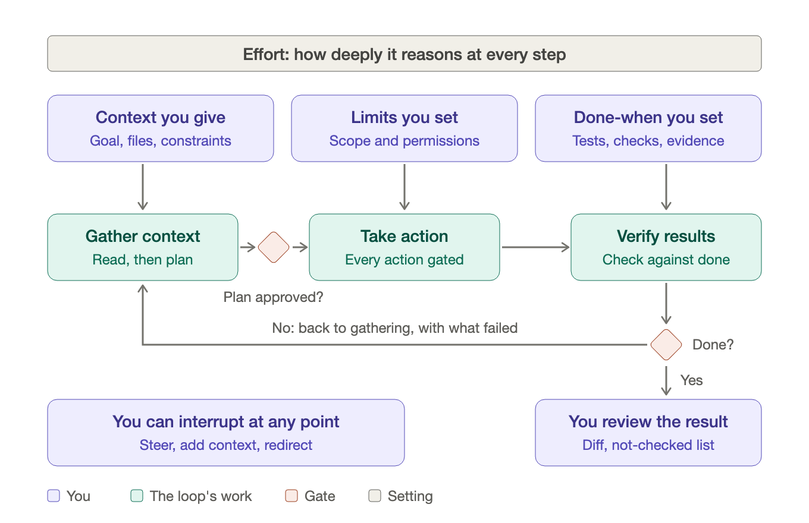
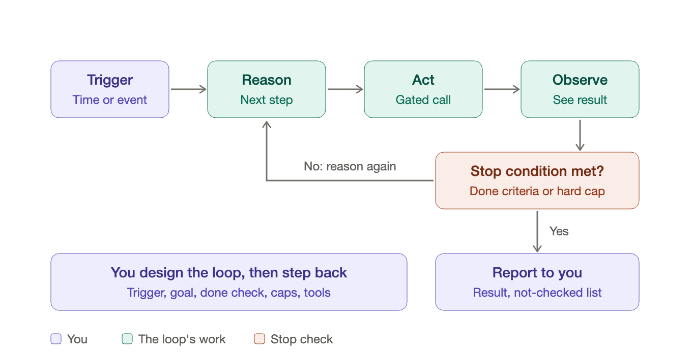

# Agents: the agentic loop

Two pictures of the agentic loop. Each is an SVG with a PNG copy.

## The loop with the person in it

Source: [agentic-loop-with-person.svg](agentic-loop-with-person.svg)

An agent works in three phases: gather context, take action, verify results. The person supplies context, limits and a done condition before it starts, can interrupt at any point, and reviews the result. A gate stops the agent before it acts until the plan is approved, and another decides whether it is done. An effort setting controls how deeply the model reasons at every step. If the check fails, the loop goes back to gathering with what failed.

## The designed loop: trigger to stop

Source: [agentic-loop-trigger-to-stop.svg](agentic-loop-trigger-to-stop.svg)

A loop is a trigger, an action and a stop condition. The trigger (a schedule, an event, a webhook or a person's command) starts a run. The agent reasons, acts through a gated call, and observes the result. The stop condition ends the run when the done criteria are met or a hard cap is hit; otherwise the agent reasons again. The person designs the trigger, the goal, the done check, the caps and the tools, and then steps back.

## Two terms

- Stop condition: ends the run. The done criteria are met, or a hard cap on passes, time or cost is hit.
- Phase gate: pauses between phases. The agent stops and shows evidence that the phase's exit criteria are met before it starts the next phase.
